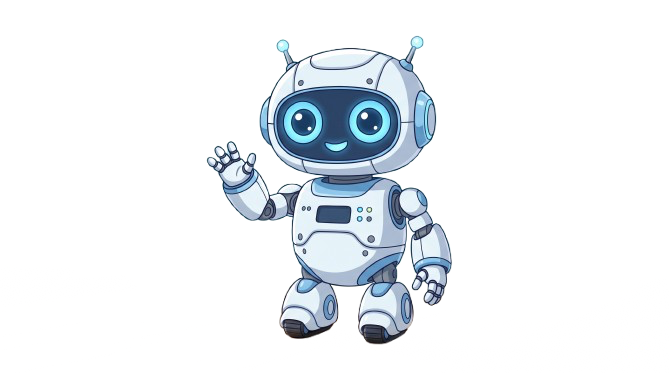
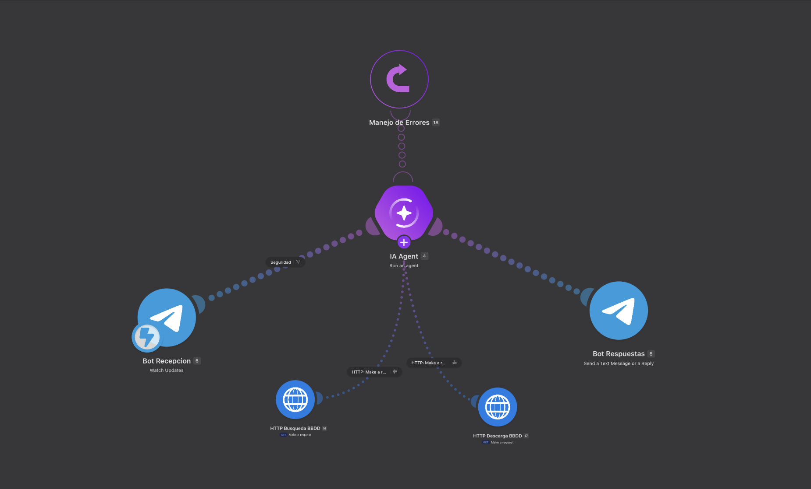
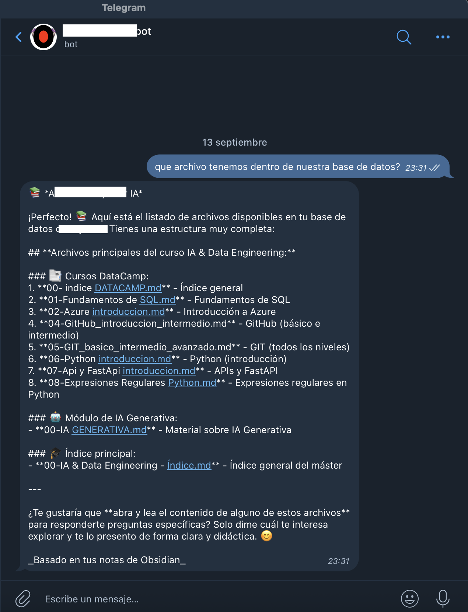

<p align="center">
  
</p>

# AI Study Bot 🚀

Bot de Telegram con IA que conecta Obsidian y Google Drive para consultar tus apuntes, buscar información relevante y generar respuestas basadas en el contenido de tu curso.

## ¿Qué hace?

Tienes tus apuntes de Obsidian (.md) sincronizados con Google Drive. Al enviar una pregunta al bot:

- Busca el contenido relevante en Google Drive.
- Lee las notas mediante la Google Drive API.
- Utiliza un AI Agent para generar la respuesta basándose en tus notas.
- Devuelve la respuesta directamente en Telegram.
- Restringe el acceso mediante Chat ID.

<p align="center">
  
  
</p>


## Arquitectura

```text
Tú ─────► Telegram
 │
 ▼

 │
 ▼
Make
 ├───────── Google Drive
 │                      │
 │                      ▼
 │              Notas de Obsidian
 │                      │
 ▼                      ▼
AI Agent ◄──────────────┘
 │
 ▼
Telegram
 │
 ▼
Tú
```

## Componentes

- **Telegram Bot** — Interfaz de chat.
- **[Make.com](http://Make.com)** — Orquestación del flujo.
- **Make AI Agent** — Motor de IA.
- **LLM** — Generación de respuestas.
- **Google Drive API** — Búsqueda y lectura de notas.
- **Google OAuth 2.0** — Autenticación.
- **Obsidian** — Gestión de las notas.

## Cómo Montarlo

### Requisitos

- Cuenta en [Make.com](http://Make.com).
- Cuenta de Google con Google Drive.
- Cuenta de Telegram.
- Obsidian instalado, si quieres utilizar tus propias notas.

### 1. Crear el Bot de Telegram

1. Abre Telegram y busca `@BotFather`.
2. Crea un nuevo bot.
3. Guarda el TOKEN proporcionado.

### 2. Preparar Google Drive

Crea una carpeta para tus notas y sincronízala con Google Drive.

```text
Mi Bóveda/
└── Curso/
    ├── modulo-1.md
    ├── modulo-2.md
    └── apuntes.md
```

### 3. Configurar Google Cloud

1. Crea un proyecto en Google Cloud Console.
2. Activa la Google Drive API.
3. Crea unas credenciales OAuth 2.0.
4. Configura las URLs de redireccionamiento necesarias para Make.
5. Guarda el Client ID y Client Secret.
6. Añade tu cuenta como usuario de prueba en la pantalla de consentimiento OAuth.

### 4. Importar el escenario en Make

En Make:
`Scenarios` --> `Create a new scenario` --> `···` --> `Import Blueprint`

Importa el archivo:
`bot-blueprint.json`

Después configura las conexiones de Telegram, Google Drive, HTTP OAuth y Make AI Agent.

### 5. Configurar el AI Agent

Personaliza las instrucciones del agente para que utilice las notas como fuente de información.


### 6. Configurar el acceso

Para permitir únicamente tu usuario, añade un filtro mediante tu Chat ID.

Obtén tu Chat ID enviando un mensaje al bot y ejecutando el escenario en Make.

Ejemplo:
```text
{{6.message.chat.id}} == TU_CHAT_ID
```

### 7. Activar

Configura el escenario para ejecutarse:
`Immediately as data arrives`

Activa el escenario y envía una pregunta al bot desde Telegram.

## Variables

- `BOT_TOKEN` — Token del bot de Telegram.
- `CHAT_ID` — ID del usuario autorizado.
- `CLIENT_ID` — Google Cloud OAuth Client ID.
- `CLIENT_SECRET` — Google Cloud OAuth Client Secret.
- `FOLDER_ID` — ID de la carpeta de Google Drive.

> No subas credenciales reales al repositorio.

## Contribuciones 🤝

Las Pull Requests son bienvenidas.

1. Haz un fork del repositorio.
2. Crea una nueva rama.
3. Realiza tus cambios.
4. Abre un Pull Request.
